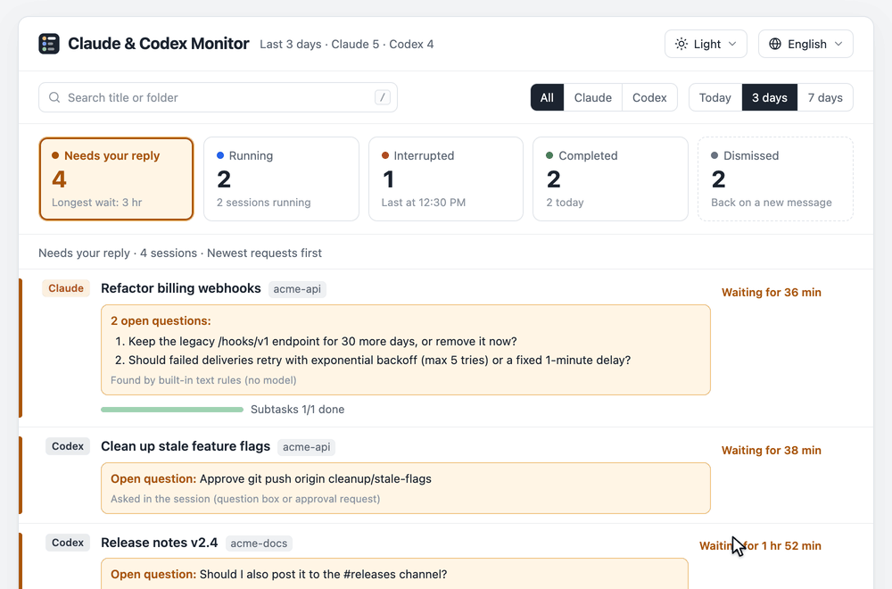
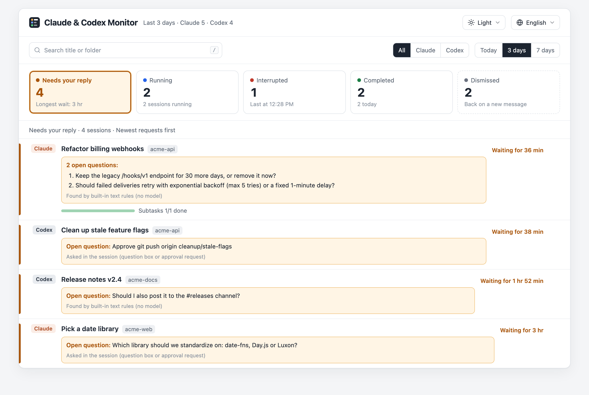
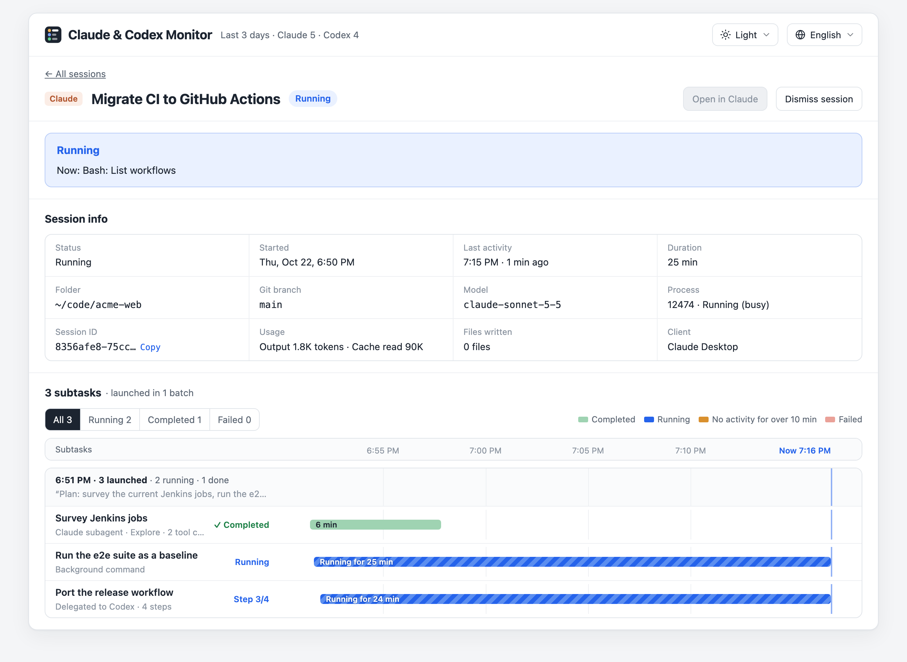
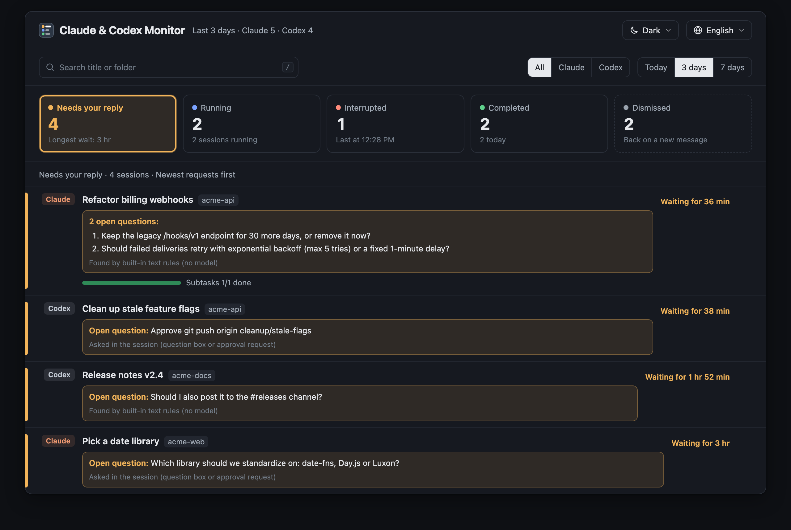
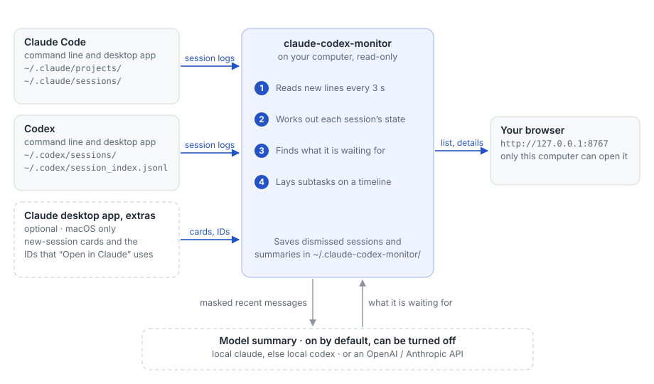
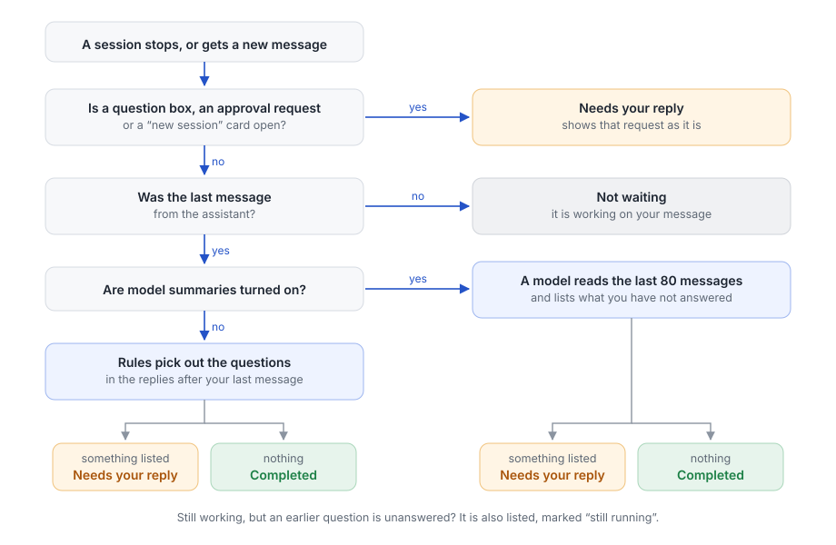
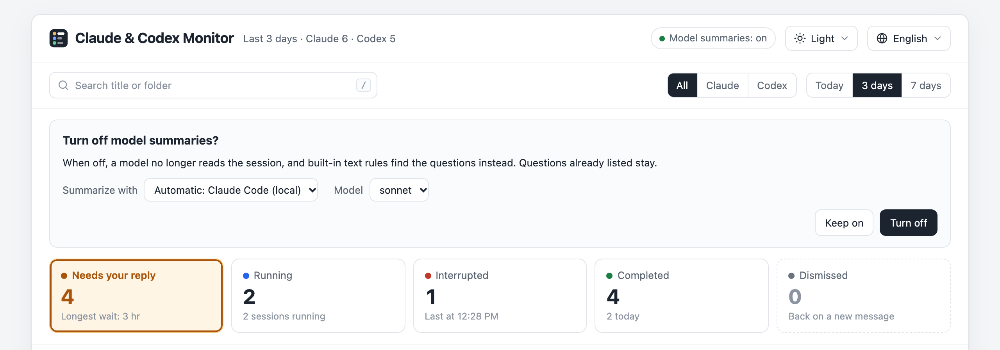

# Claude & Codex Monitor

[](https://github.com/sotaof/claude-codex-monitor/actions/workflows/test.yml)

English | [中文](README.zh-CN.md)

Claude & Codex Monitor is an open-source local web page for your **Claude Code** and **Codex** sessions.

It shows which sessions are waiting for you and what they are asking, which are still working, and how the subtasks
each session started are doing.

It reads the session logs on your computer without changing them, and needs only Python 3.9 or newer.



## Getting started

```bash
git clone https://github.com/sotaof/claude-codex-monitor
cd claude-codex-monitor
python3 run.py
```

The page opens in your browser at `http://127.0.0.1:8767/?token=…`. The browser remembers the token, so later
<http://127.0.0.1:8767/> is enough. Add `--no-open` if you don't want the
browser to open.

- It needs Python 3.9 or newer and nothing else. On a Mac, Python comes with the Xcode Command Line Tools; macOS offers
  to install them the first time you run `git` or `python3`.
- It finds the sessions that Claude Code and Codex (command line or desktop app) have written on this computer. There
  is nothing to set up.
- If Claude Code or Codex is installed, it also has a model summarize what each session is waiting for, through
  that command and your account. `--summary off` turns this off; see [Model summaries](#model-summaries).
- If it finds no sessions, the page lists the folders it looked in.
- `python3 run.py --demo` shows made-up sessions instead.

## What you see



| | |
|---|---|
| **Needs your reply** | Sessions that stopped to ask you something, with the questions listed |
| **Running** | Sessions still working, and which step they are on |
| **Interrupted** | Sessions that stopped on an error or were cut off |
| **Completed** | Finished sessions; dismiss them once you have read them |
| **Dismissed** | Sessions you set aside; they come back when there is a new message |

Open a session to see its details and every subtask it started, grouped by batch on a timeline: subagents, background
commands, `codex exec` and `claude -p` runs, new sessions it opened, workflows, Codex plan steps and child threads.



Light and dark themes, English and 简体中文. Session titles and text stay in the language they were written in.

<details><summary>Dark theme</summary>



</details>

## How it works



What it reads, without changing anything:

- Claude Code (command line and desktop app): session logs in `~/.claude/projects/`, and `~/.claude/sessions/` to tell
  whether a session's process is still running.
- Codex (command line and desktop app): session logs in `~/.codex/sessions/`, and thread titles in
  `~/.codex/session_index.jsonl`.
- Claude desktop app, optional and macOS only: `~/Library/Application Support/Claude/claude-code-sessions/`, for
  "start a new session" cards and the IDs that the "Open in Claude" button uses.

Every 3 seconds it reads only the lines added since the last read, works out each session's state, finds what each
session is waiting for, and puts subtasks on a timeline.

It writes to `~/.claude-codex-monitor/` (or `--state-dir`), readable only by you: which sessions you dismissed, cached
summaries, whether model summaries are on, which tool and model they use (`settings.json`), the page's access token
(`token`), and the log when it starts at login (`monitor.log`). Besides that, starting at login adds one file to `~/Library/LaunchAgents/` or
`~/.config/systemd/user/`, and the command line summaries and `--demo` use a temporary folder.

The page is served on `127.0.0.1:8767`, so only this computer can open it, and only with the access token.

Model summaries are on by default: the masked text of a session's recent messages goes to a model through your local
`claude` command (or `codex`, if `claude` is not installed), and the model returns what the session is waiting for.
With summaries off, or with neither command installed, nothing is sent anywhere.

## How it decides a session needs you



When a session stops or gets a new message:

1. If a question box, an approval request or a "start a new session" card is open, the session needs your reply, and
   that request is shown as it is.
2. Otherwise, if the last message is yours, the session is not waiting: it is working on your message.
3. Otherwise the last message is the assistant's. If model summaries are on, a model reads the last 80 messages and
   lists what you have not answered yet. If they are off, rules pick out the questions in the replies after your last
   message.
4. If anything is listed, the session needs your reply. If not, it is completed.

A session that is still running but has an earlier question you have not answered is also listed under Needs your
reply, marked "still running".

The rules work offline, but they can list a question the assistant already settled, or miss a request that is not
phrased as a question. A model can tell which questions you already answered.

## Model summaries

By default (`--summary auto`) the monitor uses your local `claude` command, or `codex` if `claude` is not installed.
`claude` comes first because every tool is switched off for it and each call costs far fewer extra tokens. If neither
is installed, the rules are used. Choose another way with `--summary`:

| `--summary` | Sends to | Uses | Notes |
|---|---|---|---|
| `auto` (default) | as `claude-cli`, else as `codex-cli` | | nothing is sent when neither command is installed |
| `off` | nothing | | questions are picked out of the replies by rules |
| `claude-cli` | Anthropic, through your local `claude` command | your Claude plan | default model `sonnet`; tools, MCP servers, skills and hooks are switched off, but your CLAUDE.md is read as usual, so what it asks for (such as the reply language) applies to summaries too; no session log is written; about 900 extra input tokens per call, plus your CLAUDE.md |
| `codex-cli` | the provider your local `codex` command uses | your Codex usage | your Codex default model unless `--model` is given; read-only sandbox; no session log; each call adds tens of thousands of input tokens, mostly codex's own instructions and tools |
| `openai` | `--base-url`, default `$OPENAI_BASE_URL` or `https://api.openai.com/v1` | your API key | `--model` is required; works with any OpenAI-compatible server, such as OpenRouter or a local gateway |
| `anthropic` | `--base-url`, default `$ANTHROPIC_BASE_URL` or `https://api.anthropic.com` | your API key | default model `claude-sonnet-5-5` |

```bash
python3 run.py --summary off                 # rules only, nothing is sent
python3 run.py --summary claude-cli          # your local Claude Code
python3 run.py --summary codex-cli           # your local Codex
OPENAI_API_KEY=... python3 run.py --summary openai --model <model>
CCM_API_KEY=... python3 run.py --summary openai --base-url https://openrouter.ai/api/v1 --model <provider/model>
ANTHROPIC_API_KEY=... python3 run.py --summary anthropic
```



- What is sent: the last 80 text messages of a session, without tool output or file contents, at most 40,000
  characters.
- Summaries are on from the first start. To turn them off, click **Model summaries: on** at the top of the page; the
  choice is remembered. While they are off, nothing is sent until you click **Turn on**.
- The same panel switches between Automatic, Claude Code (local) and Codex (local), and picks the model: sonnet, opus or
  haiku for `claude`, any model name for `codex` (empty for its default). The change applies at once, waiting sessions
  are summarized again with the new model, and the choice is saved in `~/.claude-codex-monitor/settings.json`.
- `--summary` or `--model` given at startup (or `CCM_SUMMARY` / `CCM_MODEL`) take priority: the page then shows what
  they set and cannot change it. API addresses and keys are only ever set at startup.
- Text that looks like an API key, token, password, a password in a connection string, a cookie, a private key, an
  email address or a phone number is replaced with a placeholder before sending.
- In the author's tests a summary took 2–6 seconds through an API and 9–16 seconds through the command line tools,
  which run one call at a time. Until a summary arrives, the page shows what the rules found.
- In the author's tests Haiku judged one waiting session as "not waiting" three times in a row, so Sonnet is the
  default. If that risk is fine for you, pick haiku in the page; it costs less.

## Start it at login

```bash
python3 run.py --install-autostart
```

This starts the monitor now and every time you log in, with the other options you put on the same command, for example
`python3 run.py --days 3 --install-autostart`. It prints the page address with the token and does not open the
browser at login. If the port is already in use, nothing is installed. To undo it:

```bash
python3 run.py --remove-autostart
```

- macOS uses a LaunchAgent, Linux a systemd user service. The log is `~/.claude-codex-monitor/monitor.log`.
- API keys are not saved, because the file is plain text. Use `claude-cli` or `codex-cli`, or add the key to the file
  yourself.
- Stop any copy you started by hand first, since both would use the same port.

## Risks

- Model summaries are on by default when `claude` or `codex` is installed, so the last 80 text messages of a session
  go to Anthropic through `claude`, or to the provider `codex` uses, and count against that plan. Start with
  `--summary off`, or turn them off in the page, if that is not acceptable. Masking works by pattern, so a secret in an
  unusual format can get through.
- `codex-cli` hands the conversation to an agent that can run commands. It runs in Codex's read-only sandbox and cannot
  change files, but text in a conversation (for example from a web page the session read) could try to make it read
  local files and put them in its summary. The summary is only shown on your own page. `claude-cli` has every tool
  switched off, so this does not apply to it. `auto` only picks `codex` when `claude` is not installed.
- The page and its data need the access token in `~/.claude-codex-monitor/token`, which only you can read. Programs
  that run as you can read that file, as they can read your session logs anyway. The browser keeps the token in a
  cookie for `127.0.0.1`, and browsers send such a cookie to every port on `127.0.0.1`: a program on another port of
  this computer that your browser opens can read the token. With `--no-token`, anyone on this computer can open the
  page and see everything on it.
- The log formats it reads are not documented. An update to Claude Code, Codex or the Claude desktop app can break part
  of it. The parts that read the desktop app's files (new-session cards, "Open in Claude" buttons) can be switched off
  with `--no-desktop`.

## Limits

- macOS has every feature. On Linux the desktop app features are missing, and it has only been tested in CI. Windows
  is not supported.
- Whether a Claude Code session is working or idle comes from its process records, so sessions run in other ways may
  show a less precise state.

## Troubleshooting

- The page says it needs its access token: run `python3 run.py` again. When the monitor is already running, this only
  opens the page with the token. You can also add `?token=` and the content of `~/.claude-codex-monitor/token` to the
  address.
- To open the page in another browser, add the token to the address yourself; running `python3 run.py` again only opens
  your default browser. On macOS, for Chrome:

  ```bash
  open -a "Google Chrome" "http://127.0.0.1:8767/?token=$(cat ~/.claude-codex-monitor/token)"
  ```

  On Linux, use your browser's command, such as `google-chrome`, in place of `open -a "Google Chrome"`.
- The port is in use: if a monitor is already running there, starting another one just opens its page. If another
  program has the port, start with another one, for example `python3 run.py --port 8768`.
- Summaries do not appear: the page says the summary failed and when it retries, and shows the questions the rules
  found meanwhile. Usually the local `claude` is not signed in (run `claude` once in a terminal and sign in), or
  `claude` / `codex` is not on `PATH`, which is common when only the desktop apps are installed. Click the Model
  summaries tag at the top: a tool that was not found is marked "not installed". With neither found, the tag is not
  shown at all.
- The list is empty: the page lists the folders it looked in and whether each exists. If your data is somewhere else,
  start with `--claude-dir` or `--codex-dir`.
- It started at login but the page does not open: see `~/.claude-codex-monitor/monitor.log`.

## Options

Most options can also be set with an environment variable.

| Option | Environment | Default | |
|---|---|---|---|
| `--port` | `CCM_PORT` | `8767` | port on 127.0.0.1 |
| `--days` | `CCM_DAYS` | `7` | days of sessions to scan; the page's date filter goes up to this |
| `--lang en\|zh` | `CCM_LANG` | the browser's language | page language; the menu on the page overrides it |
| `--lock-lang` | `CCM_LOCK_LANG=1` | off | always use `--lang` and hide the language menu |
| `--summary` | `CCM_SUMMARY` | `auto` | `auto`, `off`, `claude-cli`, `codex-cli`, `openai`, `anthropic`; overrides the page |
| `--model` | `CCM_MODEL` | see above | model for the summary; overrides the page |
| `--base-url` | `CCM_BASE_URL` | see above | API address for `openai` / `anthropic` |
| | `CCM_API_KEY` | | API key; falls back to `OPENAI_API_KEY` / `ANTHROPIC_API_KEY` |
| `--state-dir` | `CCM_STATE_DIR` | `~/.claude-codex-monitor` | dismissed sessions, summary cache, summary on / off, tool and model |
| `--claude-dir` | `CLAUDE_CONFIG_DIR` | `~/.claude` | Claude Code data |
| `--codex-dir` | `CODEX_HOME` | `~/.codex` | Codex data |
| `--no-desktop` | `CCM_NO_DESKTOP=1` | off | don't read the Claude desktop app's files |
| `--no-open` | `CCM_NO_OPEN=1` | off | don't open the page in the browser after starting |
| `--no-token` | `CCM_NO_TOKEN=1` | off | open the page without the access token; only on a computer you don't share |
| `--demo` | `CCM_DEMO=1` | off | made-up sessions only |
| `--install-autostart` | | | start now and at every login |
| `--remove-autostart` | | | remove the login item |
| `--version` | | | print the version |

`?lang=zh` or `?theme=dark` in the page address overrides the saved choice for that visit.

## Install it as a command (optional)

```bash
pipx install git+https://github.com/sotaof/claude-codex-monitor
claude-codex-monitor            # same options as python3 run.py
```

## Uninstall

```bash
python3 run.py --remove-autostart          # if you set it to start at login
rm -rf ~/.claude-codex-monitor             # dismissed sessions, summary cache, settings
```

Then delete the `claude-codex-monitor` folder you cloned, or run `pipx uninstall claude-codex-monitor` if you installed
it with pipx.

## Development

```bash
PYTHONPATH=src python3 -m unittest discover -s tests
python3 run.py --demo --port 8769
```

Standard library only. `collect.py` reads the logs, `server.py` works out each session's state and serves the page,
`summarize.py` handles the rules and the model summaries, `autostart.py` the login item, and `static/` holds the page,
its translations and the icons. See [CONTRIBUTING.md](CONTRIBUTING.md), and report security problems as described in
[SECURITY.md](SECURITY.md).

## License

[MIT](LICENSE)
