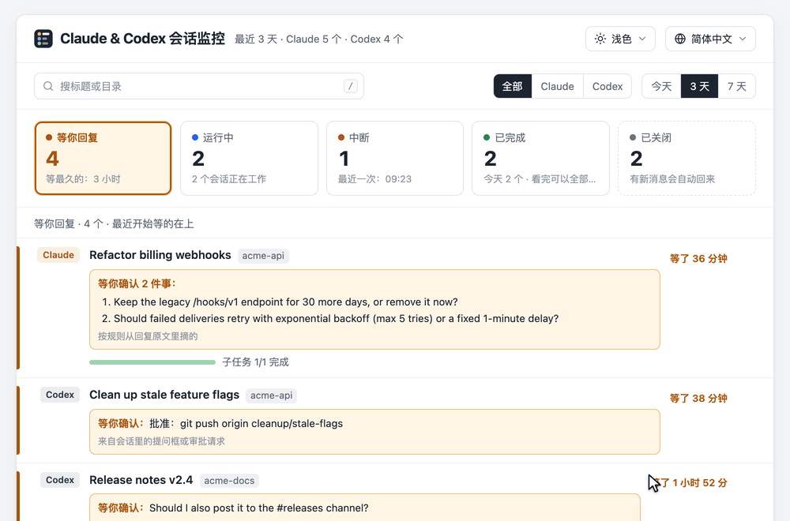
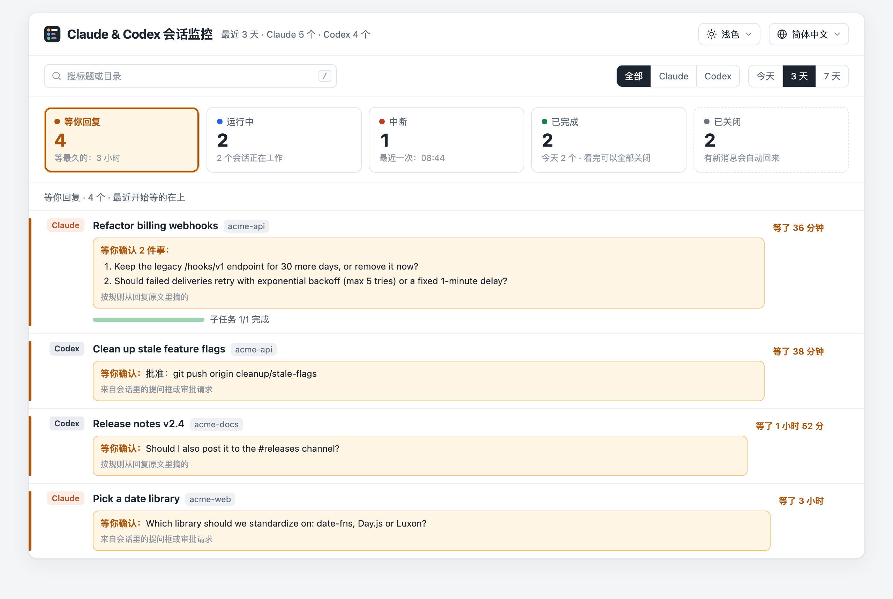
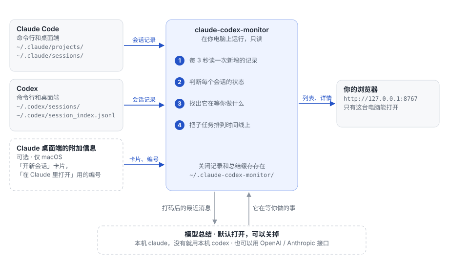
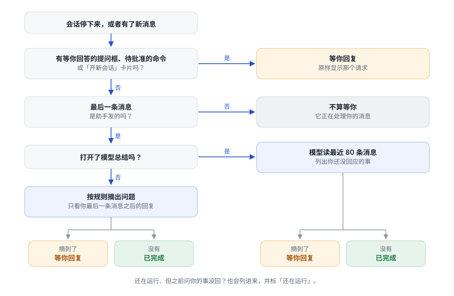
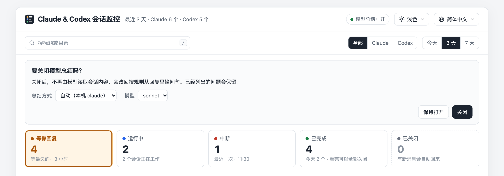

# Claude & Codex 会话监控

[](https://github.com/sotaof/claude-codex-monitor/actions/workflows/test.yml)

[English](README.md) | 中文

Claude & Codex 会话监控是一个开源的本机网页，用来查看你的 **Claude Code** 和 **Codex** 会话。

它会列出哪些会话在等你回复、问了你什么，哪些还在跑，每个会话派出去的子任务做到哪了。

它只读取本机的会话记录，不做任何修改，只需要 Python 3.9 或更新的版本。



## 安装和启动

```bash
git clone https://github.com/sotaof/claude-codex-monitor
cd claude-codex-monitor
python3 run.py
```

启动后浏览器会自动打开 `http://127.0.0.1:8767/?token=…`。浏览器会记住口令，以后直接打开 <http://127.0.0.1:8767/> 就行。不想自动打开浏览器，加 `--no-open`。

- 只需要 Python 3.9 或更高版本，不用装别的。Mac 上 Python 随 Xcode 命令行工具一起安装，第一次运行 `git` 或 `python3` 时系统会提示安装。
- 它会自己找到 Claude Code 和 Codex（命令行或桌面端）在这台电脑上留下的会话记录，不用设置。
- 装了 Claude Code 或 Codex 的话，还会通过那个命令、用你的账号，让模型总结每个会话在等你做什么。加 `--summary off` 可以关掉，见[模型总结](#模型总结)。
- 一个会话都没找到时，页面会列出它找过的目录。
- `python3 run.py --demo` 显示虚构的会话。

## 页面内容



| | |
|---|---|
| **等你回复** | 停下来问你问题的会话，问题逐条列出来 |
| **运行中** | 还在工作的会话，以及做到哪一步 |
| **中断** | 出错停下或被打断的会话 |
| **已完成** | 做完的会话；看完可以关掉 |
| **已关闭** | 你暂时放到一边的会话；有新消息时会回到列表 |

点开一个会话，能看到它的详细信息，以及它派出去的每个子任务，按一起派出的批次排在时间线上：子助手、后台命令、`codex exec` 和 `claude -p`、它开出去的新会话、Workflow，以及 Codex 的计划步骤和子线程。


支持浅色、深色，English、简体中文。会话标题和内容按原文的语言显示，不随页面语言变化。

<details><summary>深色效果</summary>


</details>

## 工作方式



只读、不修改的文件：

- Claude Code（命令行和桌面端）：`~/.claude/projects/` 里的会话记录；`~/.claude/sessions/` 用来判断会话的进程还在不在。
- Codex（命令行和桌面端）：`~/.codex/sessions/` 里的会话记录；`~/.codex/session_index.jsonl` 里的会话标题。
- Claude 桌面端，可选，仅 macOS：`~/Library/Application Support/Claude/claude-code-sessions/`，用来读「开新会话」卡片，以及「在 Claude 里打开」按钮要用的编号。

每 3 秒只读一次上次之后新增的行，然后判断每个会话的状态，找出它在等你做什么，把子任务排到时间线上。

往 `~/.claude-codex-monitor/`（或 `--state-dir` 指定的目录）里写，这些文件只有你自己能读：你关掉了哪些会话、总结缓存、模型总结开没开、用哪个工具和模型（`settings.json`）、页面的口令（`token`），以及开机自启时的日志（`monitor.log`）。另外，开机自启会在 `~/Library/LaunchAgents/` 或 `~/.config/systemd/user/` 里放一个文件；命令行方式的总结和 `--demo` 会用一个临时目录。

页面只在 `127.0.0.1:8767` 上提供，只有这台电脑能打开，而且要带口令。

模型总结默认打开：会话最近的消息打码后，经由本机的 `claude` 命令（没装 `claude` 就用 `codex`）发给模型，模型返回这个会话在等你做的事。关掉模型总结，或者两个命令都没装，就不会往外发任何内容。

## 怎么判断一个会话在等你



会话停下来，或者有了新消息时：

1. 有等你回答的提问框、待批准的命令或「开新会话」卡片：算等你回复，原样显示那个请求。
2. 没有的话，看最后一条消息。是你发的：不算等你，它正在处理你的消息。
3. 是助手发的：打开了模型总结，就由模型读最近 80 条消息，列出你还没回应的事；没打开，就按规则从你最后一条消息之后的回复里摘出问题。
4. 列出了内容：等你回复。什么都没有：已完成。

还在运行、但之前问你的事你还没回，也会列在「等你回复」里，并标上「还在运行」。

规则不联网就能用，但可能把助手自己已经定了的问题也列出来，或者漏掉没写成问句的请求。模型能分辨哪些问题你已经回过了。

## 模型总结

默认（`--summary auto`）用本机的 `claude` 命令，没装 `claude` 就用 `codex`，两个都没装就按规则摘问句。先用 `claude`，是因为它关掉了全部工具，每次调用多出的 token 也少得多。也可以用 `--summary` 换一种方式：

| `--summary` | 发到哪里 | 用谁的额度 | 说明 |
|---|---|---|---|
| `auto`（默认） | 同 `claude-cli`，没装就同 `codex-cli` | | 两个命令都没装时不发送 |
| `off` | 不发送 | | 按规则从回复里摘问句 |
| `claude-cli` | 经由本机 `claude` 命令发到 Anthropic | 你的 Claude 订阅 | 默认模型 `sonnet`；关掉了工具、MCP、技能和钩子，但照常读你的 CLAUDE.md，里面的要求（比如回复语言）对总结同样有效；不写会话记录；每次多约 900 输入 token，再加上你 CLAUDE.md 的长度 |
| `codex-cli` | 本机 `codex` 命令配置的模型服务 | 你的 Codex 额度 | 不指定 `--model` 就用 Codex 的默认模型；只读沙箱，不写会话记录；每次额外多出数万输入 token，主要是 codex 自己的系统提示和工具说明 |
| `openai` | `--base-url`，默认 `$OPENAI_BASE_URL` 或 `https://api.openai.com/v1` | 你的 API key | 必须指定 `--model`；OpenRouter、本机网关这类 OpenAI 兼容接口都能用 |
| `anthropic` | `--base-url`，默认 `$ANTHROPIC_BASE_URL` 或 `https://api.anthropic.com` | 你的 API key | 默认模型 `claude-sonnet-5-5` |

```bash
python3 run.py --summary off                 # 只用规则，不发送任何内容
python3 run.py --summary claude-cli          # 本机的 Claude Code
python3 run.py --summary codex-cli           # 本机的 Codex
OPENAI_API_KEY=... python3 run.py --summary openai --model <模型名>
CCM_API_KEY=... python3 run.py --summary openai --base-url https://openrouter.ai/api/v1 --model <提供方/模型名>
ANTHROPIC_API_KEY=... python3 run.py --summary anthropic
```



- 发送内容：会话最近 80 条文字消息，不含工具输出和文件内容，最多 4 万字。
- 第一次启动就是打开的。要关掉，点页面顶部的「模型总结：开」，选择会被记住；关掉之后，点「打开」之前不会发出任何内容。
- 同一个面板里可以选总结方式（自动、本机 `claude`、本机 `codex`）和模型：`claude` 可选 sonnet、opus、haiku，`codex` 可以填任意模型名，留空用它自己的默认模型。改完马上生效，在等你的会话会用新模型重新总结一次；选择保存在 `~/.claude-codex-monitor/settings.json`。
- 启动时给了 `--summary` 或 `--model`（或者设了 `CCM_SUMMARY` / `CCM_MODEL`），就以启动参数为准，页面上只显示、不能改。接口地址和 API key 只能在启动时设。
- 像 API key、token、密码、连接串里的密码、Cookie、私钥、邮箱、手机号的内容，发送前会换成占位符。
- 作者实测，走接口每次 2–6 秒，走命令行 9–16 秒，命令行一次只跑一个。总结出来之前，页面先显示规则摘出的原文。
- 作者实测时，Haiku 把一个在等回复的会话连续三次判成「没在等」，所以默认用 Sonnet。能接受这个风险的话，在页面上选 haiku 更省。

## 开机自动启动

```bash
python3 run.py --install-autostart
```

运行后马上启动，以后每次登录也会自动启动；同一条命令里的其他参数会一起保存，比如 `python3 run.py --days 3 --install-autostart`。它会打印带口令的页面地址，登录时不会自动打开浏览器。如果端口已经被占用，不会安装。取消：

```bash
python3 run.py --remove-autostart
```

- macOS 用登录启动项（LaunchAgent），Linux 用 systemd 用户服务。日志在 `~/.claude-codex-monitor/monitor.log`。
- API key 不会保存进去，因为那是明文文件。可以用 `claude-cli` 或 `codex-cli`，或者自己把 key 加进那个文件。
- 如果已经手动开着一个，先关掉，两个会抢同一个端口。

## 风险

- 装了 `claude` 或 `codex` 时，模型总结默认打开，会把会话最近 80 条文字消息经由 `claude` 发给 Anthropic，或者发给 `codex` 配置的模型服务，用的是你那边的额度。不能接受的话，启动时加 `--summary off`，或者在页面上关掉。打码按格式识别，格式少见的密钥可能漏掉。
- `codex-cli` 会把对话交给一个能执行命令的代理。它跑在 Codex 的只读沙箱里，改不了文件；但如果对话里混进了恶意文字（比如会话读过的网页），理论上可能诱导它读本机文件、写进总结。总结只显示在你自己的页面上。`claude-cli` 关掉了全部工具，没有这个问题。`auto` 只在没装 `claude` 时才用 `codex`。
- 页面和数据都要带口令才能打开，口令在 `~/.claude-codex-monitor/token`，只有你自己能读。以你的身份运行的程序能读到这个文件，就像它们本来也能读你的会话记录一样。浏览器把口令存在 `127.0.0.1` 的 Cookie 里，而浏览器会把这个 Cookie 发给 `127.0.0.1` 上的所有端口：如果你在浏览器里打开过这台电脑上别的端口的页面，那个程序就能拿到口令。加了 `--no-token` 的话，这台电脑上的任何人都能打开页面，看到上面的全部内容。
- 它读的记录格式没有公开文档。Claude Code、Codex 或 Claude 桌面端更新后，部分功能可能失效。读桌面端文件的部分（「开新会话」卡片、「在 Claude 里打开」按钮）可以用 `--no-desktop` 关掉。

## 局限

- macOS 上功能完整。Linux 上没有桌面端相关的功能，而且只在自动测试里跑过。不支持 Windows。
- Claude Code 会话「工作中 / 空闲」的判断来自它的进程记录，用其他方式运行的会话，状态可能没那么准。

## 常见问题

- 页面提示需要口令：再运行一次 `python3 run.py`。监控已经在运行时，这一步只会带着口令打开页面。也可以把 `~/.claude-codex-monitor/token` 里的内容接在网址后面：`?token=…`。
- 要在另一个浏览器里打开：自己把口令接在地址后面；再运行一次 `python3 run.py` 只会打开默认浏览器。在 Mac 上用 Chrome 打开：

  ```bash
  open -a "Google Chrome" "http://127.0.0.1:8767/?token=$(cat ~/.claude-codex-monitor/token)"
  ```

  Linux 上把 `open -a "Google Chrome"` 换成浏览器自己的命令，比如 `google-chrome`。
- 提示端口被占用：如果那个端口上已经开着一个监控，再启动只会直接打开它的页面。如果是别的程序占着，换个端口启动，比如 `python3 run.py --port 8768`。
- 模型总结一直没出来：页面上会提示这次没总结出来、多久后重试，问题先按规则摘出来显示。常见原因是本机的 `claude` 没登录（在终端里运行一次 `claude` 并登录），或者 `claude` / `codex` 不在 `PATH` 里，只装了桌面端时常见。点页面顶部的「模型总结」标签，没找到的工具会标「没装」；两个都没找到时，页面上不会出现这个标签。
- 列表是空的：页面会列出它找过的目录，以及每个目录在不在。数据放在别处的话，启动时加 `--claude-dir` 或 `--codex-dir`。
- 开机自启了但页面打不开：看 `~/.claude-codex-monitor/monitor.log`。

## 配置

大部分选项也可以用环境变量设置。

| 参数 | 环境变量 | 默认 | |
|---|---|---|---|
| `--port` | `CCM_PORT` | `8767` | 127.0.0.1 上的端口 |
| `--days` | `CCM_DAYS` | `7` | 读最近几天的会话；页面上的日期筛选最多到这个天数 |
| `--lang en\|zh` | `CCM_LANG` | 跟浏览器的语言 | 页面语言；页面上的菜单可以再改 |
| `--lock-lang` | `CCM_LOCK_LANG=1` | 关 | 固定用 `--lang`，不显示语言菜单 |
| `--summary` | `CCM_SUMMARY` | `auto` | `auto`、`off`、`claude-cli`、`codex-cli`、`openai`、`anthropic`；优先于页面上的选择 |
| `--model` | `CCM_MODEL` | 见上文 | 总结用的模型；优先于页面上的选择 |
| `--base-url` | `CCM_BASE_URL` | 见上文 | `openai` / `anthropic` 的接口地址 |
| | `CCM_API_KEY` | | API key；没设时读 `OPENAI_API_KEY` / `ANTHROPIC_API_KEY` |
| `--state-dir` | `CCM_STATE_DIR` | `~/.claude-codex-monitor` | 关闭记录、总结缓存、模型总结的开关、总结方式和模型 |
| `--claude-dir` | `CLAUDE_CONFIG_DIR` | `~/.claude` | Claude Code 数据目录 |
| `--codex-dir` | `CODEX_HOME` | `~/.codex` | Codex 数据目录 |
| `--no-desktop` | `CCM_NO_DESKTOP=1` | 关 | 不读 Claude 桌面端的文件 |
| `--no-open` | `CCM_NO_OPEN=1` | 关 | 启动后不自动打开浏览器 |
| `--no-token` | `CCM_NO_TOKEN=1` | 关 | 不用口令就能打开页面；只在不和别人共用的电脑上用 |
| `--demo` | `CCM_DEMO=1` | 关 | 只显示虚构会话 |
| `--install-autostart` | | | 现在启动，并且每次登录自动启动 |
| `--remove-autostart` | | | 取消登录自动启动 |
| `--version` | | | 显示版本号 |

页面地址里加 `?lang=zh`、`?theme=dark`，可以临时指定这一次的语言和外观。

## 装成一个命令（可选）

```bash
pipx install git+https://github.com/sotaof/claude-codex-monitor
claude-codex-monitor            # 参数和 python3 run.py 一样
```

## 卸载

```bash
python3 run.py --remove-autostart          # 装过开机自启的话
rm -rf ~/.claude-codex-monitor             # 关闭记录、总结缓存和设置
```

然后删掉克隆下来的 `claude-codex-monitor` 目录；用 pipx 装的，运行 `pipx uninstall claude-codex-monitor`。

## 开发

```bash
PYTHONPATH=src python3 -m unittest discover -s tests
python3 run.py --demo --port 8769
```

只用 Python 标准库：`collect.py` 读记录，`server.py` 判断每个会话的状态并提供页面，`summarize.py` 负责规则摘录和模型总结，`autostart.py` 负责开机启动，`static/` 是页面、中英文对照表和图标。参与开发请看 [CONTRIBUTING.md](CONTRIBUTING.md)，安全问题按 [SECURITY.md](SECURITY.md) 里的方式报告。

## 许可

[MIT](LICENSE)
